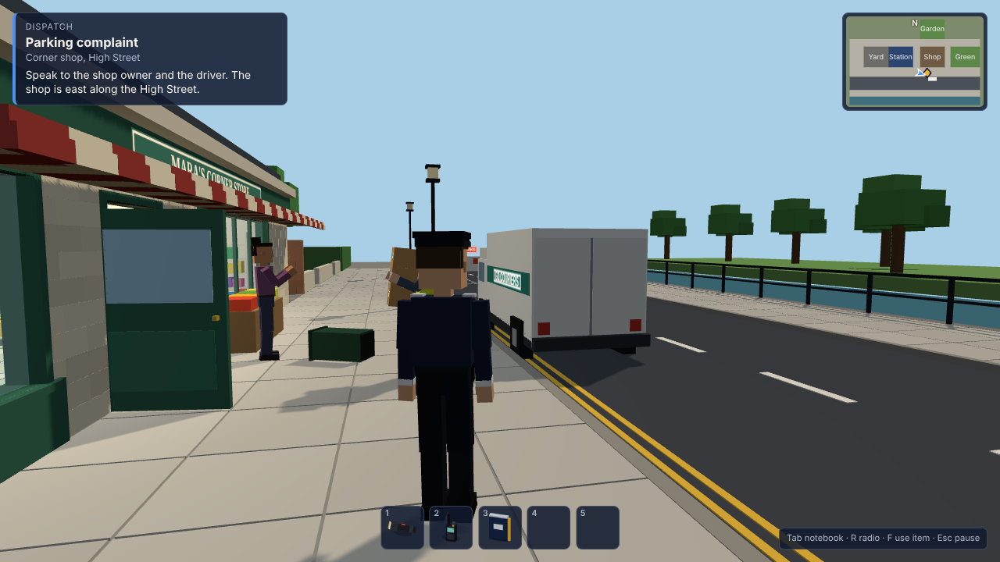

# Borough Watch

A single-player, third-person, voxel-style police sandbox for desktop browsers, set in a compact British-inspired town. Built with Three.js, Rapier and TypeScript from the planning package in [`docs/plan/`](docs/plan/00_START_HERE.md).

**Current state: first playable slice (milestones M0–M2).** One street, part of a police station, a corner shop, two alleys, a garden and a green; seven characters; two incidents; one complete shift loop with a review, an unlock and a second shift. It is not the finished town. See [`docs/STATUS.md`](docs/STATUS.md) for exactly what is verified, partial, deferred or planned.



More captures from a played shift are in [`docs/screenshots/`](docs/screenshots/): the menu, locker, briefing, High Street, a conversation, the shop, the notebook and the stockroom by torchlight.

## Run it
```
npm install
npm run dev      # http://localhost:5173
```
`npm run build` type-checks and writes a production build to `dist/`; `npm run preview` serves it. Needs a browser with WebGL 2 and WebAssembly. Keyboard and mouse only.

## Controls (all remappable in Settings)
| Key | Action |
|---|---|
| W A S D | Move, relative to the camera |
| Mouse | Look. Click the view to capture the pointer; dragging or the arrow keys also turn the camera. Mouse wheel changes camera distance |
| Shift | Sprint (uses stamina). C: walk |
| E | Interact with whatever the prompt names |
| 1–5 | Belt slots. F (or left click while the pointer is captured): use the selected item |
| 1–9 in conversation | Choose a reply. The last option always leaves |
| Tab | Notebook. R: radio. Esc: pause. F3: diagnostics |

## A first shift
1. You start in the locker room. Open your locker (the blue one) and put the torch and radio on your belt.
2. Report to Sgt Bell at the front desk for a briefing: a delivery van is parked across the corner shop.
3. Walk east along the High Street. Hear Mara (shop owner) and Glen (driver), inspect the van, then decide: ask him to move it, order him to, or let him finish and square it with Mara.
4. While you are there, something else may happen at the shop. Whether you respond, and how, is up to you. Check before you arrest: the till roll and a receipt exist for a reason.
5. Return to Sgt Bell to clock off. The review explains every reward and penalty. You unlock the evidence kit and can start the next shift straight away.

## What is distinctive in this slice
- **Contact-driven physical reactions.** Severity comes from closing speed and who brought it: a walking brush, a jogging bump, a sprinting stumble, a head-on knockdown. People drop what they carry, recover, acknowledge what happened in character, and pick their things up again — or say why they are leaving them.
- **NPCs with separate truth and belief.** Witnesses report only what they saw or heard, decided by distance, facing, line of sight and coarse sound transmission. The same incident can be a theft or an honest misunderstanding; the facts are fixed when it is staged and the evidence supports either outcome.
- **A clean HUD.** One dispatch card, a modest minimap, a five-slot belt with icons rendered from the real item models, one prompt, two-line subtitles.
- **Memory.** Residents remember being helped, ordered about, knocked over or wrongly accused, and greet you accordingly on later shifts.

## Project layout
```
src/app          lifecycle, game loop, input, the per-shift world container
src/simulation   event bus, seeded random
src/physics      Rapier wrapper, collision groups
src/world        town geometry, doors, nav graph, props, item instances, voxel mesh builder
src/characters   rig, pose library, character controller, contact → reaction pipeline
src/ai           NPC plans, perception, beliefs, memory, bystander scoring
src/incidents    shift flow, parking complaint, shop theft, notebook
src/career       career record, rewards, local save
src/presentation camera, item icon renderer, synthesised audio
src/ui           HUD, menus, locker, notebook, dialogue, review
src/content      item and resident definitions
src/dev          automated yard test (development builds only)
tools/           Playwright play-test drivers used for the checks in docs/STATUS.md
docs/            status, charter, building register, asset manifest, and the original plan
```

## Development tools (dev server only; absent from production builds)
- `F3`: frame time, draw calls, physics counts, each NPC's current intent and motion state.
- `?scenario=yard`: start in the station yard test area. `&autotest=1` runs the 20-sequence bump/fall/recovery gate.
- `?autostart=1`, `?seed=N`, `?variant=guilty|innocent`, `?who=toby|rhys`, `?shadows=0`: reproduce a specific shift.
- `node tools/qa-shift.cjs chase|innocent|escape`, `node tools/qa-yard.cjs`, `node tools/qa-lifecycle.cjs`: scripted playthroughs (need the dev server running and Playwright with Chromium).
